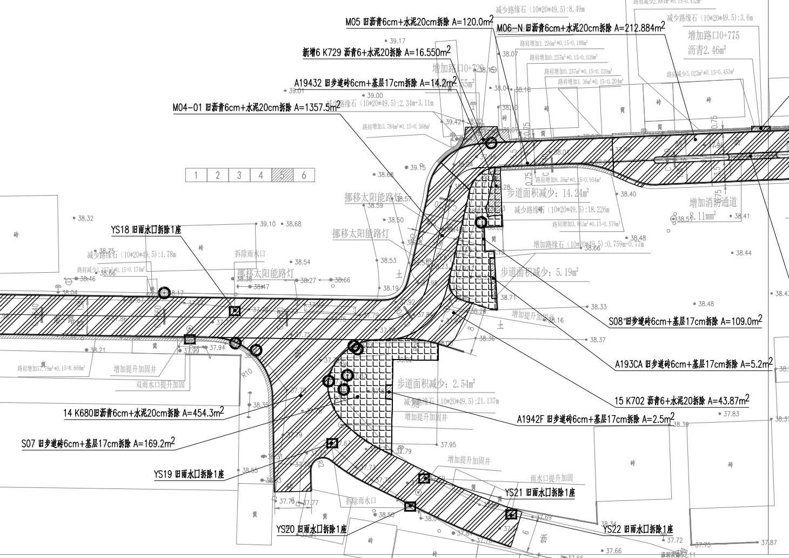

# CAD Callout Pair Layout — 引线标注 Skill

[English](README.md) · [安装](docs/INSTALL.zh-CN.md) · [兼容范围](docs/COMPATIBILITY.md) · [验证与限制](docs/VALIDATION.md)

**CAD 注释标注技能——引线注释、文字样式与智能排布。**

由AI Agent识图规划，配合小工具完成可靠、重复的几何核算。 源码预览v0.6：先读内框，再选区、分组和安排开口，最后落图、读回及看图。v0.3两两排布器保留为局部修补工具。

- 普通LEADER、可人工编辑的关联MTEXT与黄色圆点。
- 道路走向、灰色背景、空白区域和密集路口由Agent判断。
- 只读几何检查器核对明确布局，不代替Agent选区和实际图面验收。
- 两处35组实战成果已获认可；比例自动换算仍为后续接口。

| 任务 | 所需组件 | 限制 |
| --- | --- | --- |
| 已支持的基础CAD操作 | 仅底座 | 本Skill按需安装；底座当前为源码预览。 |
| 本项目引线样式与排布 | 底座＋本Skill | 完整样式／排布未由底座首版单独认证，先查原生工具缺项。 |
| 病害／拆除流程 | 底座＋本Skill＋病害拆除Skill | 专业范围由病害技能提供；独立公开规则预览 v0.1.0-rc.1。 |
| 仅计算离线几何建议 | 排布器＋Python／Shapely | 不需CAD或底座；计算成功不等于原生落图通过。 |

默认及实战证据来自米制道路图；其他专业、园林品种和毫米样式需适配，尚未验证。AI Skill／排布器不带原生写入器或自动安装，可选人工Lisp单独列明。不打包字体、工程DWG或旧COM辅助脚本；仅附用户选定的第二处PDF及截图作为展示证据。可先试[纯合成示例](docs/INSTALL.zh-CN.md)。

新增[两处35组实战](references/nanyi-field-example.md)，区分底座MCP标注与获准COM打印。历史验证及未覆盖范围见[验证说明](docs/VALIDATION.md)。

[底座](https://github.com/capskov/cad-agent-foundation)负责受支持原生操作和执行治理，本Skill负责样式参数／排布规则，安装技能不会补出缺失原生接口。[病害拆除Skill](https://github.com/capskov/cad-distress-annotation)负责专业范围与分类。本仓库：[cad-callout-pair-layout](https://github.com/capskov/cad-callout-pair-layout)。三者独立开发发布，两个Skill不设为底座的全局依赖。

[匿名综合展示案例](https://github.com/capskov/cad-agent-foundation/tree/main/examples/road-demolition)实际使用项目Python／AutoCAD COM，不是全流程底座执行证明。复现还需指定组件、核验的补充操作和清理后的CAD输入；这里不附自动回放数据。

自有源码／说明采用Apache-2.0，依赖保留自身许可，见[声明](NOTICE.md)。相关词：AutoCAD、CAD annotation、LEADER、MTEXT、callout layout、CAD Agent Skill、MCP／Model Context Protocol。本Skill不是MCP服务器或Autodesk产品。

可选人工小工具：[BZYD中英文ANSI版本与使用说明](tools/autolisp/README.zh-CN.md)。直接调整已有标注，无需底座／Python。中文版本有AutoCAD2026历史实测；AutoCAD2022和英文提示版原生运行仍待验证。

[组件结构与CAD2022／2026分层支持](docs/STRUCTURE-AND-VERSIONS.md)。未来尺寸标注另建Skill，不把规划写成当前引线Skill能力。

## 已认可的实战成果

[PDF](examples/nanyi-20261015/callout-area-2-pm.pdf) · [Evidence / 实战说明](references/nanyi-field-example.md)
